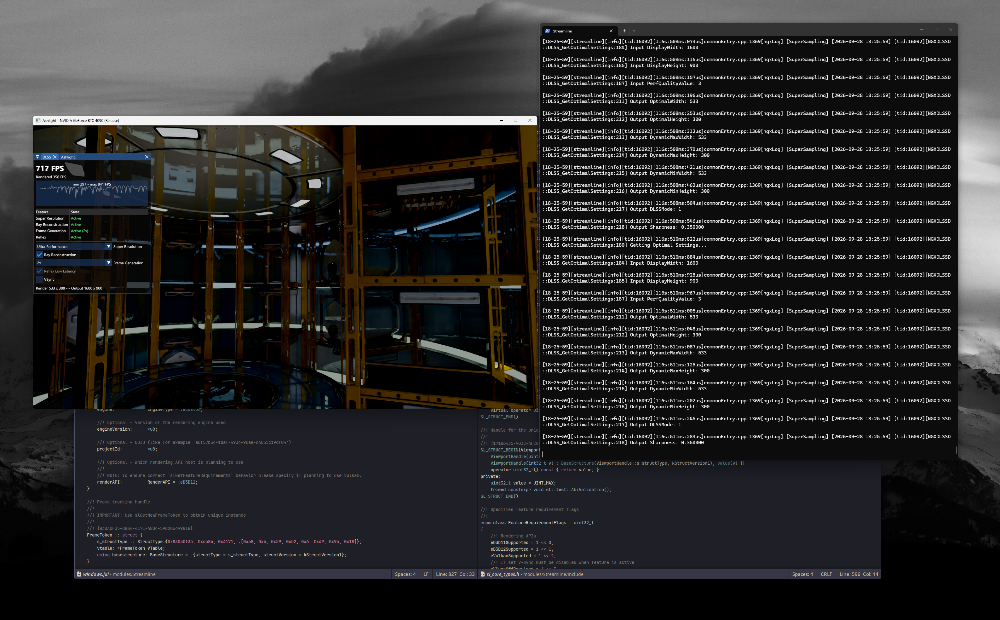

2.14.1

Not included due to their licenses:
- `nvngx_dlss.dll`, `nvngx_dlssd.dll`, `nvngx_dlssg.dll`, `nvngx_deepdvc.dll` (NVIDIA RTX SDKs License)
- `NvLowLatencyVk.dll` (NVIDIA Reflex SDK License)
- `sl.nvperf.dll` and the `sl_nvperf.h` bindings (NVIDIA Nsight Perf SDK License)

Get the DLLs from the [Streamline releases](https://github.com/NVIDIA-RTX/Streamline/releases) and put them in `bin/`.
